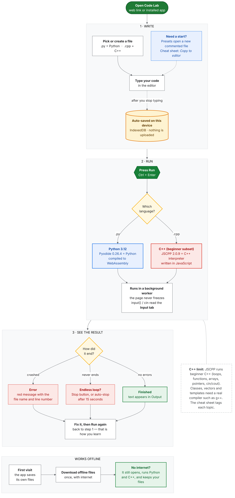

https://i-bsit-b-web-ide-for-python-and-cpp.vercel.app/
> **AI disclosure:** Written with Claude (Anthropic). Carl Ianne directed the design
# I-BSIT-B Code Lab

An offline-capable code editor for **Python** and **C++**, made for I-BSIT-B. It runs in the browser, saves students' files on their own device, and installs like an app (PWA).

New to GitHub and Vercel? Read **[docs/STEP-BY-STEP.md](docs/STEP-BY-STEP.md)**.

## What it does

- **Editor:** Monaco (the VS Code editor), with a simple editor as an automatic fallback (and the default on touch screens).
- **Runs code in the browser:** Python with Pyodide (WebAssembly), C++ with JSCPP (a beginner-level C++ interpreter). Runs happen in a background worker, so **Stop** always works, and endless programs stop after 15 seconds.
- **Saves in IndexedDB** on the student's device, with a visible "Saved on this device" note, backup and restore, and a warning in private windows.
- **Cheat sheets:** 30 Python and 31 C++ topics, sorted from easiest (level 1) to hardest (level 4), each tagged *Must-know / Good to know / Nice to have*. C++ topics also say whether they run in this app. Search, filters, and **Copy to editor**.
- **Presets:** 20 commented programs per language (hello world, loops, ASCII art, mini programs from the Mini Toolkit).
- **Offline PWA:** service worker, install button with steps for each browser, update notice.
- **Themes:** dark gray and forest green (default), or white with the Google block colors.

## How it works (flowchart)

A one-page picture for students and teachers: what happens from typing code to seeing the result, and how it keeps working with no internet.



The editable source of the picture is [docs/how-code-lab-works.mmd](docs/how-code-lab-works.mmd) (Mermaid text).

## Engine versions (what exactly runs your code)

| Language | Engine | Version | What that means |
|---|---|---|---|
| Python | Pyodide 0.26.4 (WebAssembly) | **Python 3.12** | Real CPython. The standard library works; extra packages, `turtle` and `tkinter` do not. |
| C++ | JSCPP 2.0.9 (JavaScript interpreter) | no C++ version number | A **beginner subset** that follows the basics of old-style C++ (about C++98). It is *not* a full compiler. |

Every C++ example and preset in the app is also checked against a real compiler (**g++ 13, `-std=c++17`**) by `npm test`, so the code you copy is real C++ that also works on your own computer. The versions are kept in one place (`ENGINES` in `public/js/config.js`) and a test fails if the words here, in the app, or in the engines ever drift apart.

## Honest limits

- **C++ runs on JSCPP**, which handles beginner C++ (variables, loops, functions, arrays, pointers, `cin` and `cout`, `<cmath>`, `<cstring>`). `std::string`, references (`&`), `struct`, classes, `new`/`delete`, vectors, templates, exceptions and files do **not** run here (checked one by one). The cheat sheet marks each topic *Runs here / Needs g++*; for those, copy the code to a real compiler. The app warns students in three places: the file badge says **C++ · simplified**, a one-time notice appears when they first open a C++ file, and a failed C++ run ends with a note saying the error may be an app limit and not their mistake. A full in-browser compiler (Clang in WebAssembly) would remove this limit but costs tens of MB more and is slow to start, so it was left out to keep the app light.
- Python: the standard library works; extra packages, `turtle` and `tkinter` do not.
- The first Python run downloads about 13 MB (once), then it is saved for offline use.

## Folder map

```
public/                 the website (this is what Vercel publishes)
  index.html            the page
  css/                  tokens (ALL colors) / base / layout / components
  js/
    main.js             starts the app, only connects modules (no feature logic)
    config.js           every setting in one place
    storage/            IndexedDB, file store (create, rename, backup...)
    editor/             Monaco + simple editor behind one interface
    runners/            Python and C++ workers, Stop and time limits
    content/            cheat sheet parser, presets loader
    core/               tiny helpers: dom, utils, the message bus
    app/                controllers (files, running, autosave) + one setup file per feature
    ui/                 file list, console, menus, dialogs, cheat sheet panel, theme
    pwa/                install button, offline manager, update notice
  data/                 cheat sheets (.md) and presets (.py / .cpp)
  sw.js                 service worker (offline)
scripts/build.mjs       copies engines into public/vendor, writes the offline file list
third_party/jscpp/      the C++ engine file (its npm package does not include it) + license
docs/                   the flowchart and the step-by-step deploy guide
tests/                  unit tests + a real-browser smoke test
```

## Commands

| Command | What it does |
|---|---|
| `npm install` | downloads Pyodide, Monaco, JSCPP |
| `npm run build` | copies the engines into `public/vendor` and writes the offline list |
| `npm start` | local server at http://localhost:3000 |
| `npm test` | runs the tests (examples and presets are run for real) |

## Why the code should not break

- Each feature lives in its own module and talks to the others only through small interfaces (for example, the editor is used only through `createEditor()`).
- `main.js` contains wiring only. Adding a feature means a new module plus a line or two there.
- The tests run every cheat sheet example and every preset in the real engines, so a bad example fails `npm test`.
- Database changes use numbered migrations (`storage/idb.js`), so students keep their files across updates.

## Credits and licenses

Pyodide (MPL-2.0), Monaco Editor (MIT), JSCPP (MIT). The app code is yours to license as you like.
